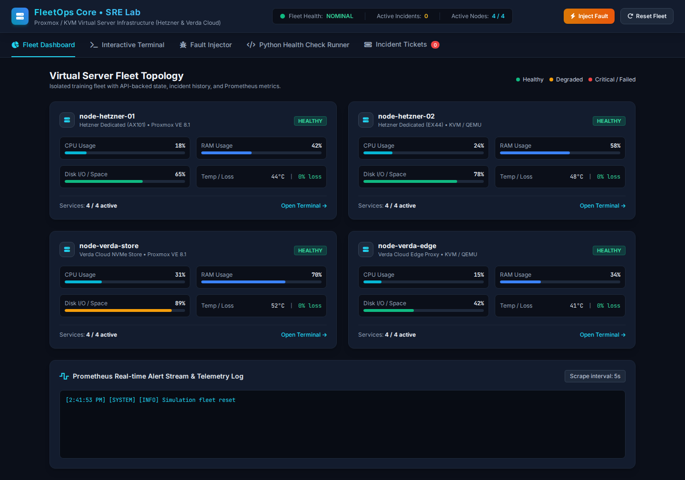
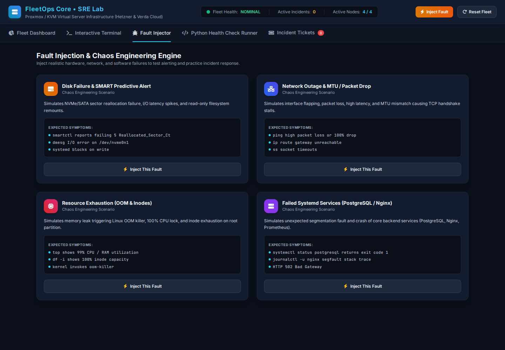
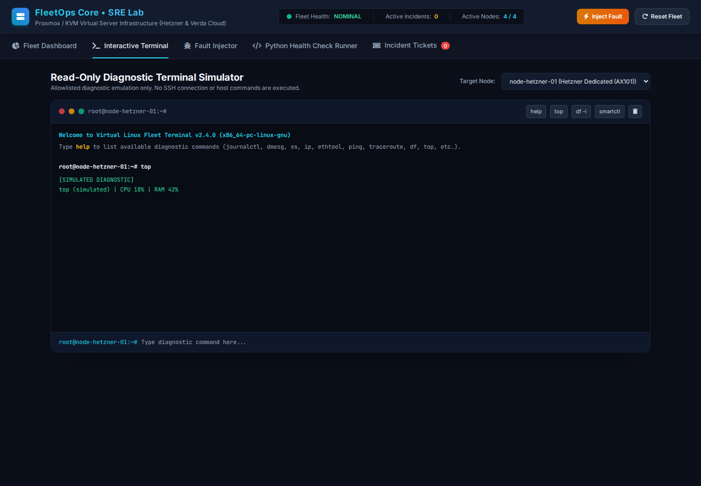
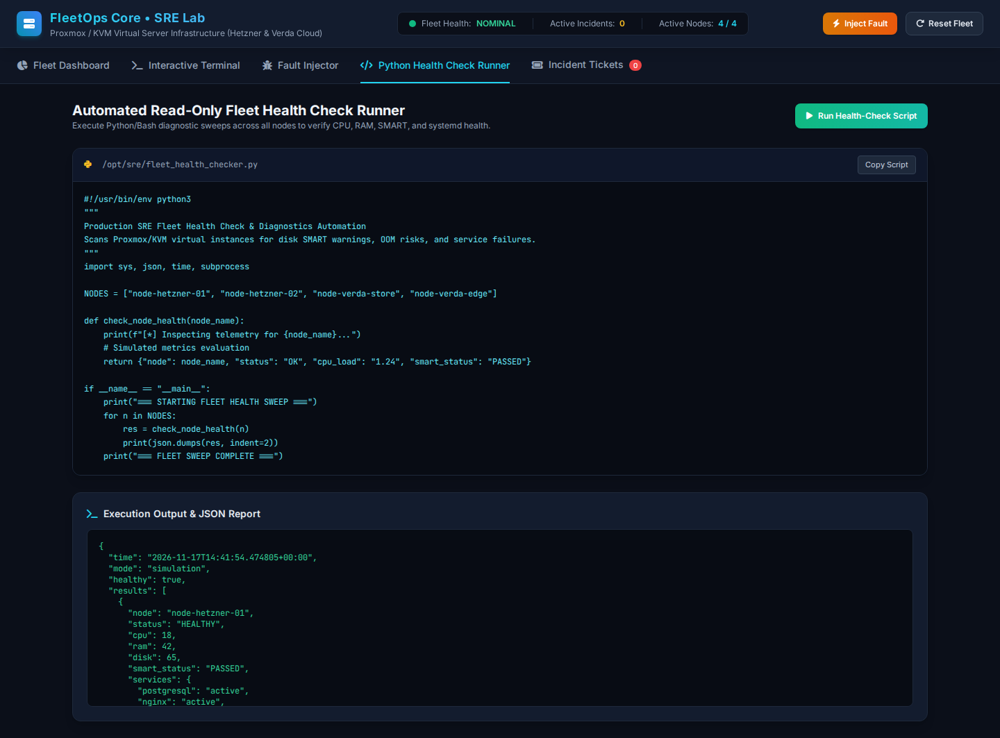
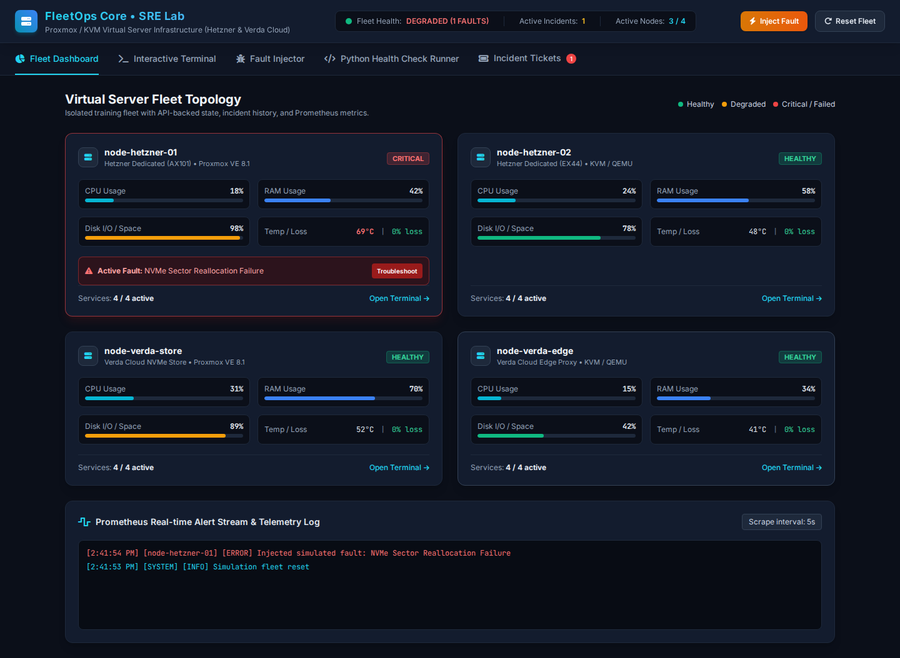
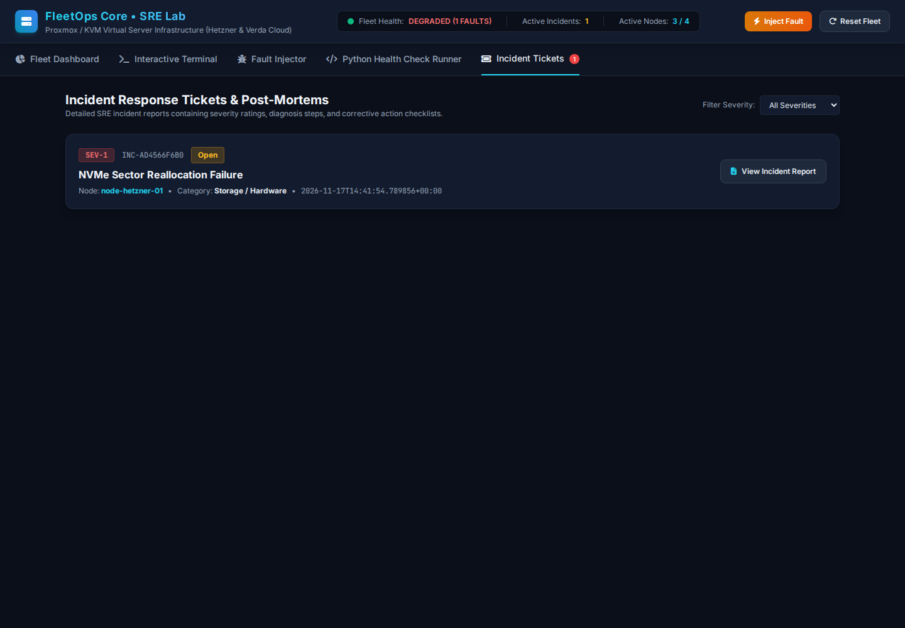

# FleetOps Core — Linux Fleet Operations & Fault Injection SRE Lab

A functional, API-backed **isolated SRE training simulator** built from the original five-tab HTML prototype. It models four virtual nodes labelled after example Hetzner and Verda infrastructure; **it does not connect to those companies' infrastructure**, provision Proxmox/KVM VMs, open SSH connections, or manipulate production systems.

## Project showcase

**FleetOps Core** is a five-tab site-reliability engineering (SRE) training application with a browser dashboard and a Python FastAPI service. It demonstrates a reproducible *simulated* incident-response lifecycle rather than operating real Hetzner, Verda, Proxmox, or KVM machines.

### Screenshots from browser integration testing

Screenshots are captured automatically from the **running FastAPI application** by [Playwright](scripts/capture_screenshots.py). The [browser screenshot workflow](.github/workflows/screenshots.yml) runs the app on an ephemeral GitHub Actions Linux runner, opens and clicks each page, checks a simulated disk fault, confirms its incident ticket, and verifies recovery. After a successful run, the workflow attaches screenshots as a downloadable Actions artifact and commits the PNGs under `artifacts/screenshots/`. Until that workflow succeeds, images linked below may not yet exist.

| Fleet dashboard | Fault scenarios |
|:--:|:--:|
|  |  |

| Diagnostic terminal | Automated health sweep |
|:--:|:--:|
|  |  |

| Active fault | Incident ticket |
|:--:|:--:|
|  |  |

### Architecture

```text
Browser dashboard (HTML, Tailwind, JavaScript)
     | fetch API + five-second polling
FastAPI REST backend
     | persistent state
SQLite (four modeled nodes, faults, event history, tickets)
     |
     +-- GET /metrics --> Prometheus scrape
     +-- GET /api/health-check --> health sweep
     +-- POST /api/diagnostics --> allowlisted emulator (no shell)
     +-- POST /api/faults --> simulated fault state
     +-- POST /api/incidents/{id}/resolve --> verified simulated recovery
```

### Demonstrated engineering work

- Converted a standalone UI prototype into a working stateful HTTP application with persistent SQLite data and a 5-second dashboard refresh.
- Modeled **four example fleet nodes** and their CPU, RAM, disk, temperature, packet loss, and service state.
- Implemented four deterministic fault families: disk/SMART, network loss/MTU, resource exhaustion/OOM, and service failure.
- Added severity-rated incidents with root-cause descriptions, corrective checklists, and simulated recovery verification.
- Implemented a restricted diagnostic terminal that **never executes arbitrary host commands**, plus a health-check report and Prometheus-compatible endpoint.
- Packaged the application with a locked-down Docker Compose configuration, pytest API tests, GitHub Actions CI, and Playwright browser verification.

**Scope:** All node metrics and injected failures are simulated. The screenshots are evidence of the working simulator UI, **not live monitoring of external Linux servers**. Real host exporters, fault drivers, SSH, and hypervisor integrations are future extensions.

## Capabilities

- Fleet status cards with CPU, RAM, disk, temperature, packet loss, service health, 5-second polling.
- Four repeatable fault scenarios: storage failure, packet loss/MTU mismatch, resource exhaustion/OOM, and application service crash.
- Incident ticket creation, severity, diagnosis, corrective guidance, recovery verification and persistent history.
- Read-only *emulated* terminal diagnostics, explicitly allowlisted; never executes user-supplied shell commands.
- JSON fleet health sweeps, Prometheus metrics endpoint, SQLite data persistence, pytest integration tests, GitHub Actions CI.
- Local-only port binding and unprivileged Docker container with dropped Linux capabilities.

## Quick start

```bash
docker compose up --build
```

Open http://localhost:8000 for the dashboard, http://localhost:8000/docs for API documentation and http://localhost:9090 for Prometheus. The Docker image installs Python dependencies and runs as an unprivileged user; no Docker socket is mounted.

Without Docker:

```bash
python -m venv .venv
source .venv/bin/activate  # Windows PowerShell: .venv\\Scripts\\Activate.ps1
pip install -r requirements-dev.txt
uvicorn app.main:app --reload
python -m pytest -q
```

## Reproducible incident demo

```bash
curl -s -X POST http://localhost:8000/api/faults -H 'Content-Type: application/json' \
 -d '{"node_id":"node-hetzner-01","fault_type":"disk"}'
curl -s http://localhost:8000/api/health-check
curl -s http://localhost:8000/metrics
```

Resolve the returned incident with `POST /api/incidents/{id}/resolve`, or use the UI. This returns simulated telemetry to baseline and verifies the simulated recovery. Only one active fault per node is allowed; duplicates return 409.

## API

| Endpoint | Description |
| --- | --- |
| `GET /api/state` | Nodes, tickets, logs |
| `POST /api/faults` | Inject an isolated fault |
| `POST /api/incidents/{id}/resolve` | Recover and verify incident |
| `POST /api/reset` | Clear incidents and reset fleet |
| `POST /api/diagnostics` | Allowlisted simulated diagnostics |
| `GET /api/health-check` | JSON health sweep |
| `GET /metrics` | Prometheus exposition |

## Scope and honest limitations

**Simulation, not hardware chaos:** disk SMART, kernel logs, service states, CPU pressure and network drops are modeled in SQLite, not sampled from Linux hosts. The original HTML health-check code block remains as a historical visual example; pressing Run now requests live application state from the backend. Prometheus *actually scrapes* the application's simulated-state metrics, but Grafana, real Linux exporters, hypervisor API connectors, container fault drivers and privileged host-level chaos tooling are **not implemented**. The labels Hetzner / Verda are illustrative, not claims of access or affiliation.

For a future real infrastructure mode: use explicit node enrollment, mTLS, least-privilege agents, authorization for destructive operations, execution audit trails and strict resource guardrails. Never inject faults into third-party hosts.
