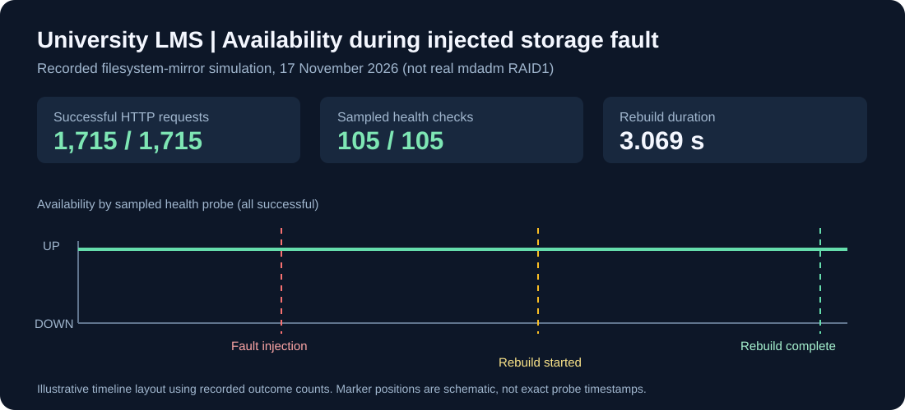
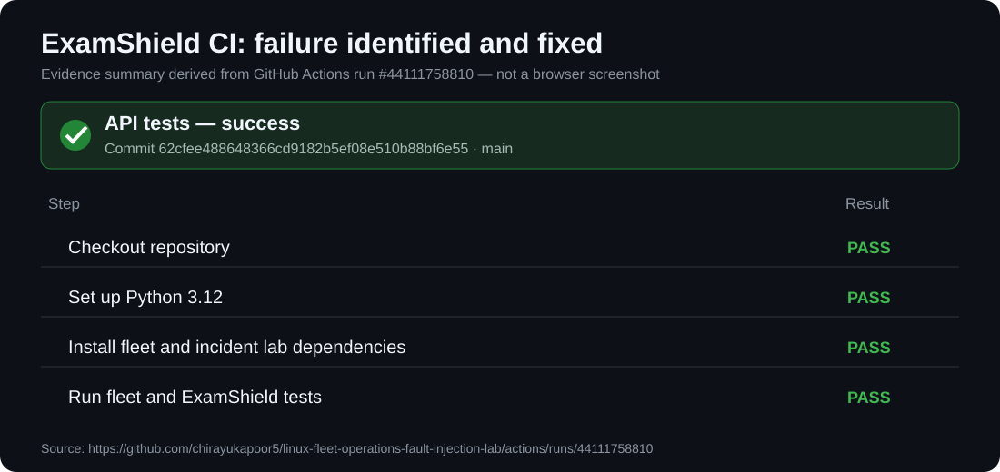

# ExamShield — RAID1 Failure During a Live University LMS Examination

**Measured fault-injection lab | FastAPI · Python · Prometheus · Grafana · Linux mdadm (separate Ubuntu VM path)**

During a campus-wide final exam, students continuously autosave answers, submit finals, and retry responses after network timeouts. At the worst moment, one storage replica fails. This lab measures the availability, durability, alert delay, and recovery behaviour of a simplified educational LMS.

## Critical honesty about execution modes

1. **Safe, portable simulation (tested here):** Two directories represent mirrored storage devices. One can be disabled while FastAPI receives real HTTP requests. Mirror recovery copies files and reconciles concurrent writes. These are *not* Linux RAID1 block devices, and the logs do *not* establish `mdadm` resiliency.
2. **Actual Linux RAID1 (Ubuntu VM, not executed in this environment):** `scripts/real_mdadm_ubuntu.sh` creates an mdadm RAID1 with two scratch loop files, runs a background read/write process, marks one disk failed, replaces it with a third, monitors `/proc/mdstat`, and captures kernel and checksum logs. Run **only on an isolated disposable Ubuntu VM**; `mdadm` and loop devices and privileges are required.

## Scenario: finals-week autosave + ambiguous acknowledgments

A network timeout during exam submission is not equivalent to data loss. If a student retries the same request ID, the LMS should return the **original receipt** rather than create an inconsistent duplicate. Our test deliberately retries one final submission during the degraded state and verifies both identity and readback after rebuilding.

## Run the simulated incident

```bash
python -m pip install -r requirements.txt
uvicorn examshield.server:app --host 127.0.0.1 --port 8765
# In another shell:
python scripts/run_incident.py --students 80 --seconds 10 --out evidence
pytest -q
```

Dashboard: http://localhost:8765 · Prometheus endpoint: http://localhost:8765/metrics.

To run Grafana + Prometheus (requires Docker):

```bash
docker compose up --build -d
# LMS http://localhost:8765 · Prometheus http://localhost:9090 · Grafana http://localhost:3000
```

The simulator's `/admin/fail` and `/admin/rebuild` endpoints are **deliberately unauthenticated** for localhost lab use; do not expose this service on public networks.

## Generate actual mdadm evidence on Ubuntu (separate run)

```bash
sudo apt-get update && sudo apt-get install -y mdadm e2fsprogs util-linux
sudo I_ACCEPT_SCRATCH_RAID=YES bash scripts/real_mdadm_ubuntu.sh
```

This Linux script manipulates virtual block devices and requires privileges. Verify the `/dev/md/examshield-lab` array is unused before running. It is not integrated with the HTTP LMS workload; for real service-over-RAID evidence, mount your application's data directory on the mdadm array and configure a dedicated deployment.

## Incident evidence and CI verification

The measured incident used **80 simulated students** exercising a filesystem-mirror-backed LMS. The recorded results are from the **simulation** (not the actual Ubuntu `mdadm` script).



| Measured outcome | Recorded result |
| --- | ---: |
| HTTP workload requests | 1,715 |
| Successful HTTP requests | 1,715 / 1,715 |
| Sampled HTTP health checks | 105 / 105 |
| Failure detection latency | 0.020 s |
| Replica rebuild duration | 3.069 s |
| Post-recovery replicas | 1,716 files on each |
| Post-recovery SHA-256 comparison | Matched |
| Duplicate final submission retry | Same original receipt |
| Acknowledged answer readback | Verified |

**Source of measurements:** [Recorded metrics](evidence/metrics.json), [checksum results](evidence/checksum_results.json), and [incident report](evidence/incident_report.md). The image above is a **rendered evidence summary, not a screenshot of a live application or Grafana**. Its phase-marker positions are illustrative, not independently timed samples.

### GitHub Actions: failed import and successful repair

The first CI attempt failed **during test discovery** because the `examshield` Python package lives under `incidents/examshield-raid1-lms/`, but the root-level workflow had not configured that directory on the Python module search path.

```text
ERROR collecting incidents/examshield-raid1-lms/tests/test_core.py
ModuleNotFoundError: No module named 'examshield'
Process completed with exit code 2.
```

The fix in [commit `62cfee4`](https://github.com/chirayukapoor5/linux-fleet-operations-fault-injection-lab/commit/62cfee488648366cd9182b5ef08e510b88bf6e55) updates [the repository CI workflow](https://github.com/chirayukapoor5/linux-fleet-operations-fault-injection-lab/blob/main/.github/workflows/ci.yml) to install ExamShield's dependencies and set `PYTHONPATH` to its package directory.



- **Failed CI run:** [API tests #30](https://github.com/chirayukapoor5/linux-fleet-operations-fault-injection-lab/actions/runs/44111331248) — import error during collection.
- **Successful rerun:** [API tests, run #44111758810](https://github.com/chirayukapoor5/linux-fleet-operations-fault-injection-lab/actions/runs/44111758810) — dependency installation and the fleet + ExamShield tests passed.
- **Evidence caveat:** The CI image is a custom SVG summary derived from verified GitHub Actions step results; it is **not a captured GitHub webpage screenshot**. The linked run is the authoritative source.

CI verifies the Python test suite; it does not prove live `mdadm` RAID1 fault recovery or Grafana deployment.

## Evidence directories

Published evidence includes `evidence/metrics.json`, `evidence/checksum_results.json`, `evidence/incident_report.md`, `evidence/availability_summary.svg` and `evidence/github_actions_success.svg`. The full locally generated ZIP also contains raw probes, timelines and PNG charts that have not been committed to the repository. No authentic Grafana screenshot was captured.

## Investigation runbook

On a real Ubuntu VM: `cat /proc/mdstat`, `sudo mdadm --detail /dev/md/examshield-lab`, `sudo dmesg --ctime | tail -100`, `systemctl status <your-lms-service>`, `sha256sum <sample-files>`. Correlate RAID degraded state with Prometheus alerts, client probe results, recovery duration, and final checksum verification.

## Known boundaries

- Failover in a directory mirror is not a faithful emulation of Linux RAID1 scheduling, disk I/O, or filesystem semantics.
- The sample checksum comparison is of two *simulation replicas* and does not verify physical disks or silent preexisting corruption.
- Sampled health availability is not end-user availability nor proof of a production service SLA.
- The real mdadm path does not yet integrate an LMS service; it independently validates block-layer rebuilds.
- Docker/Grafana configurations are supplied but not necessarily executed in environments without Docker.

**Safe for a portfolio when represented as a measured simulation + optional Ubuntu RAID integration exercise, not a production incident.**